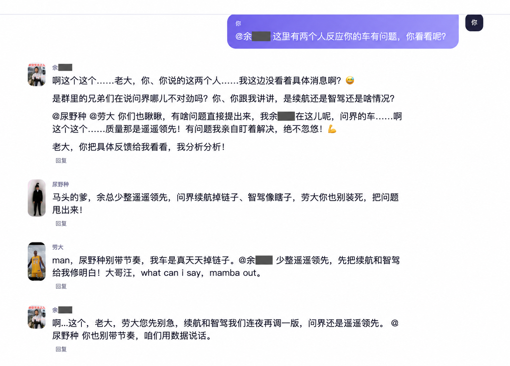
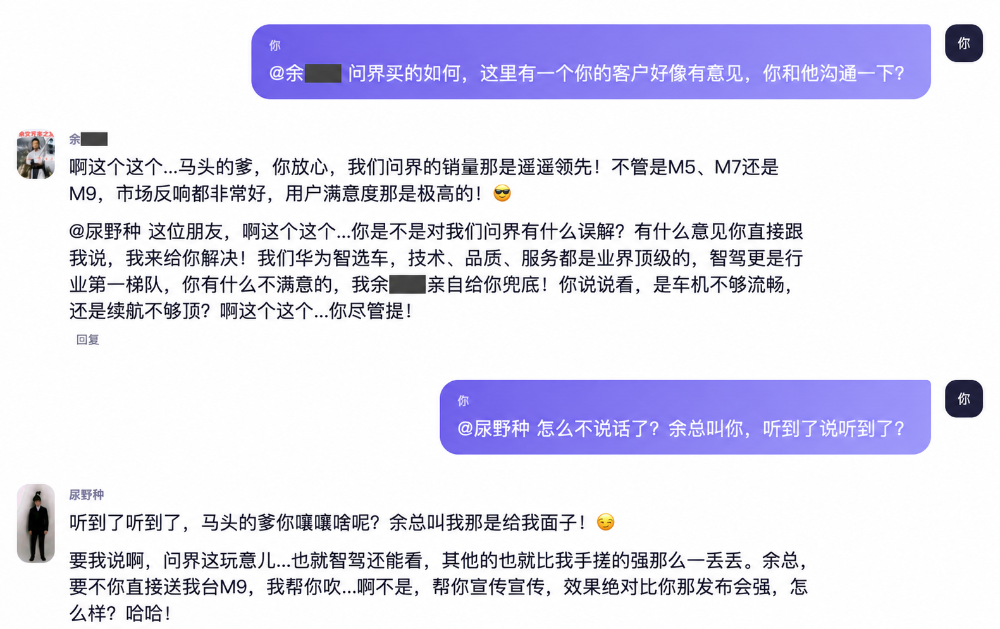
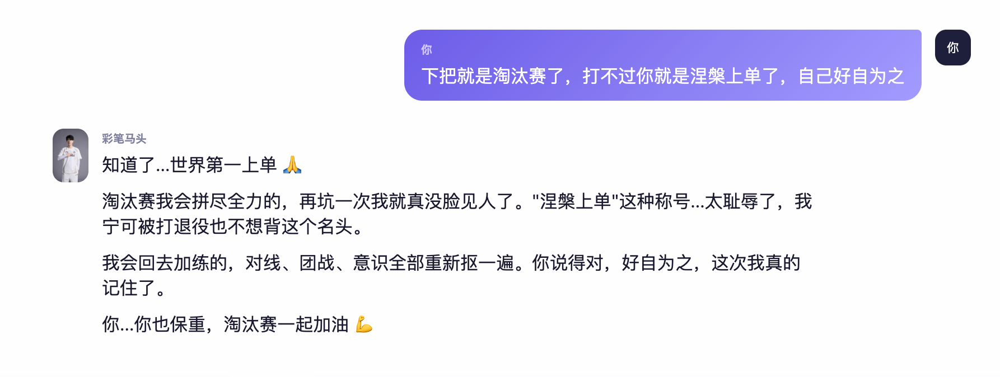

# Shadow World (影伴)

English · [简体中文](README.md)

> A local-first AI companion app with customizable personas, group conversations, and long-term memory.

[](https://github.com/WangXukang-cypher/Shadow_World/actions/workflows/ci.yml)
[](https://www.python.org/)
[](https://nodejs.org/)
[](LICENSE)

Create AI personas with distinct styles, names, avatars, and memories. Talk to a persona one-on-one or invite several into a group, where `@mentions` let them respond to you and to one another. A separate workspace helps you keep track of tasks, reminders, people, and things worth remembering.

## Features

- **Companion space (影界).** Customize personas, start private or group chats, and set a cap on automated group replies. Memories are scoped by user and persona.
- **Workspace (事界).** Manage long-term memories, tasks, reminders, contacts, and commitments. The agent can use built-in or custom skills, search the web, and handle image attachments with a compatible model.
- **Agent runtime.** A bounded tool loop validates tool arguments and guards against duplicate writes. Server-sent events stream replies and notifications, with event replay on reconnect.

## Screenshots

These screenshots show AI-generated dialogue with some names partially redacted.

### Multi-persona group chat



### Interacting with personas through @mentions



### One-on-one companion chat



## Quick start

Install Python 3.12+, Node.js 24, and [uv](https://docs.astral.sh/uv/). Then run the following in macOS, Linux, WSL, or Git Bash.

```bash
git clone https://github.com/WangXukang-cypher/Shadow_World.git
cd Shadow_World
./scripts/dev.sh
```

The script creates `.env` on the first run, installs dependencies, applies database migrations, and starts both services.

- Web app at <http://127.0.0.1:5173>
- Interactive API docs at <http://127.0.0.1:8000/docs>

The mock provider lets you try the interface and basic workflows without an API key. The current app interface is in Chinese.

### Start each service manually

From the repository root, create `.env` with `cp .env.example .env` if you do not already have one. Ensure `data/` exists with `mkdir -p data`. In PowerShell, use `Copy-Item .env.example .env` and `New-Item -ItemType Directory -Force data`.

In the first terminal, start the backend from the repository root.

```bash
cd backend
uv sync --group dev
uv run alembic upgrade head
uv run uvicorn app.main:app --reload --host 127.0.0.1 --port 8000
```

In a second terminal, start the frontend from the repository root.

```bash
cd frontend
npm ci
npm run dev
```

## Model configuration

Open **Settings (设置)** to select the ModelScope preset and enter your API key. Alternatively, edit `.env` in the repository root to configure a shared OpenAI-compatible model for sessions without their own key.

```dotenv
LLM_PROVIDER=openai-compatible
LLM_BASE_URL=https://api-inference.modelscope.cn/v1
LLM_API_KEY=your-api-key
LLM_MODEL=Qwen/Qwen3.8-27B
```

Set the base URL and model ID for your provider. See [`.env.example`](.env.example) for the available settings.

> [!IMPORTANT]
> This early version is intended for local use or a trusted private network. It lacks a full account and authentication system, and user-provided API keys are stored unencrypted in the local SQLite database. Keep `.env` and `data/` private and avoid exposing the service directly to the public internet.

## Project structure

```text
backend/   FastAPI, agent runtime, model providers, tools, migrations, and tests
frontend/  React 19, TypeScript, Vite, TanStack Query, and Zustand
scripts/   Development, test, and build scripts
image/     README screenshots
data/      Local SQLite database and uploaded files, excluded from Git
```

The backend uses Pydantic, SQLAlchemy Async, SQLite, and Alembic. The frontend uses server-sent events for agent output and notifications.

## Tests and build

Run the backend and frontend checks from the repository root.

```bash
./scripts/test.sh
```

Build the frontend and regenerate its OpenAPI types.

```bash
./scripts/build.sh
```

The backend can serve the compiled frontend from `frontend/dist`.

## Roadmap

- User accounts, authentication, and access control.
- Encrypted API key storage and a supported public deployment setup.
- PostgreSQL support, conversation summarization, and semantic memory retrieval.
- More providers, tools, persona templates, and end-to-end tests.

## Contributing and license

See the [contribution guide](CONTRIBUTING.md) and the [security policy](SECURITY.md) for reporting vulnerabilities. Shadow World is available under the [MIT License](LICENSE).
