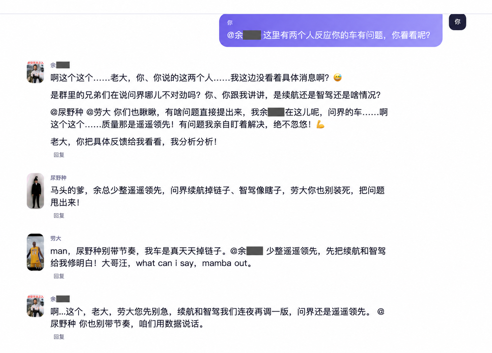
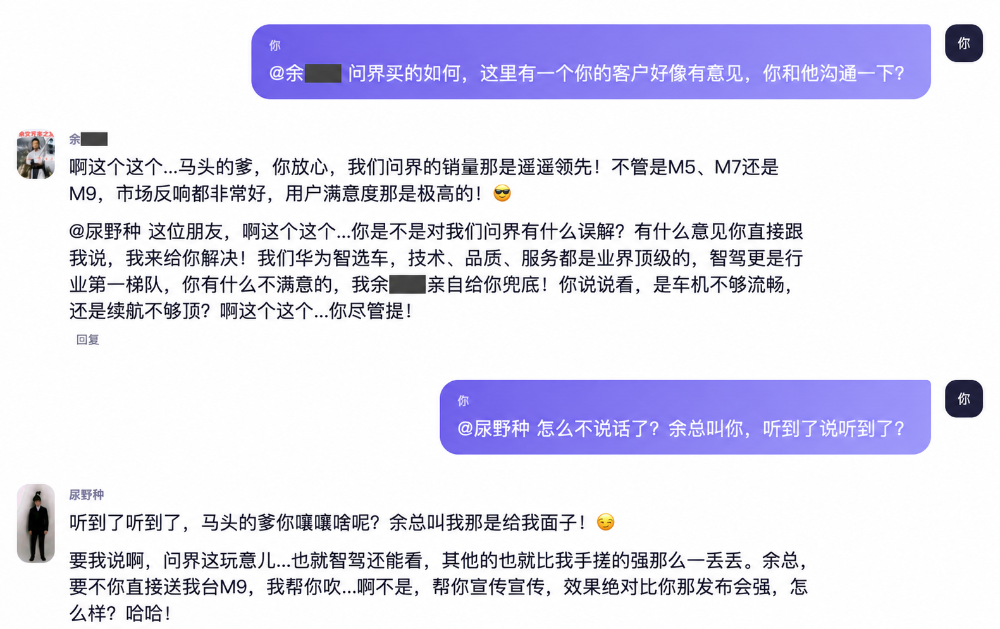
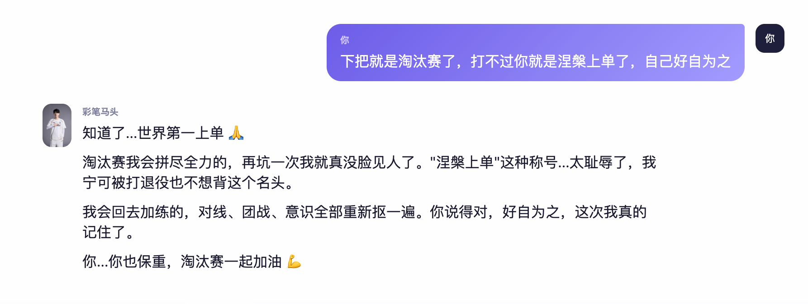

# Shadow World（影伴）

[English](README.en.md) · 简体中文

> 一个可自定义人格、支持群聊接力与长期记忆的本地优先 AI 社交空间。

[](https://github.com/WangXukang-cypher/Shadow_World/actions/workflows/ci.yml)
[](https://www.python.org/)
[](https://nodejs.org/)
[](LICENSE)

Shadow World 不只是一个问答助手。你可以创建多个拥有独立性格、称呼、头像和记忆的 AI 人格，与它们私聊，或把它们拉进同一个群聊，通过 `@mention` 让角色彼此接话。项目同时提供带记忆、待办、提醒、人物关系、技能与搜索工具的个人工作台。

> [!IMPORTANT]
> 项目仍处于早期开发阶段，当前更适合本机开发、演示和可信内网体验。尚未提供正式账号鉴权与 API Key 加密存储，请勿将服务直接暴露到公网。

## 界面预览

截图展示 AI 角色生成的对话，部分名字已遮挡。

### 多人格群聊与自动接力



### 通过 @mention 驱动角色互动



### 私聊与独立记忆



## 主要能力

### 影界：多人格社交空间

- 创建和编辑自定义人格：名称、对话风格、性格、称呼、头像与模型偏好。
- 与单个人格进行 1:1 私聊，或创建包含多个人格的群聊。
- 使用 `@mention` 指定发言者；人格也可以在回复中提及其他人格并触发接力。
- 为群聊人格设置自动回复轮次上限，防止对话无限扩散。
- 按用户与人格隔离记忆，减少不同角色之间的上下文污染。

### 事界：AI 工作台

- 长期记忆的创建、查询、更新与删除。
- 待办事项、自然语言时间解析、到期提醒与通知流。
- 人物资料、关系与承诺记录。
- 内置技能、自定义技能和技能调用。
- 当前时间与 DuckDuckGo 网络搜索工具。
- 图片上传、多模态消息和流式 Markdown 回复。

### 工程能力

- 有界 Agent Tool Loop，支持工具白名单、Pydantic 参数校验、超时与写操作幂等。
- 基于 Server-Sent Events（SSE）的运行流与通知流，支持事件补发和断线重连。
- Token Budget、历史裁剪与长期记忆注入。
- SQLAlchemy Async + SQLite + Alembic 数据迁移。
- 后端单元/集成/契约测试与前端组件测试。

## 技术栈

| 层级 | 技术 |
| --- | --- |
| 前端 | React 19、TypeScript、Vite、TanStack Query、Zustand |
| 后端 | FastAPI、Pydantic、SQLAlchemy Async、Alembic |
| 数据 | SQLite（默认）、本地文件存储 |
| 模型 | ModelScope 预设或 OpenAI-compatible API |
| 实时通信 | Server-Sent Events（SSE） |
| 工程工具 | uv、pytest、Ruff、Vitest、ESLint |

## 快速开始

### 环境要求

- Python 3.12+
- Node.js 24
- [uv](https://docs.astral.sh/uv/)

### 一键启动

在 macOS、Linux、WSL 或 Git Bash 中运行：

```bash
git clone https://github.com/WangXukang-cypher/Shadow_World.git
cd Shadow_World
./scripts/dev.sh
```

脚本会创建本地 `.env`、安装依赖、执行数据库迁移，并同时启动前后端：

- Web 界面：<http://127.0.0.1:5173>
- API 文档：<http://127.0.0.1:8000/docs>

未配置模型 Key 时，应用会使用 Mock Provider，因此可以先体验界面和基础流程。

### 手动启动

先准备配置和数据目录：

```bash
cp .env.example .env
mkdir -p data
```

终端一（后端）：

```bash
cd backend
uv sync --group dev
uv run alembic upgrade head
uv run uvicorn app.main:app --reload --host 127.0.0.1 --port 8000
```

终端二（前端）：

```bash
cd frontend
npm install
npm run dev
```

Windows PowerShell 用户可分别使用 `Copy-Item .env.example .env` 和 `New-Item -ItemType Directory -Force data` 完成前两步，其余命令相同。

## 配置真实模型

启动后进入「设置」页面，选择 ModelScope 并填写自己的 API Key。用户级 Key 保存在本地数据库中，仅供对应的本地用户会话使用。

也可以在根目录 `.env` 中配置一个全局 OpenAI-compatible 模型，作为未配置个人 Key 时的兜底：

```dotenv
LLM_PROVIDER=openai-compatible
LLM_BASE_URL=https://api-inference.modelscope.cn/v1
LLM_API_KEY=your-api-key
LLM_MODEL=Qwen/Qwen3.8-27B
```

只要服务实现兼容的 `/chat/completions` 接口，也可以换成其他模型服务。完整配置项见 [`.env.example`](.env.example)。

> [!WARNING]
> `.env` 已被 Git 忽略，请勿提交任何真实 API Key。当前用户级 Key 以明文形式存储在本地 SQLite 数据库中，请保护好 `data/` 目录并仅在可信环境运行。

## 项目结构

```text
Shadow_World/
├── backend/
│   ├── app/
│   │   ├── agent/           # Runtime、上下文构建与流式事件
│   │   ├── api/             # REST API
│   │   ├── application/     # 应用服务
│   │   ├── infrastructure/  # 数据库模型与文件存储
│   │   ├── llm/             # Mock 与 OpenAI-compatible Provider
│   │   ├── notifications/   # 提醒 Worker 与事件 Broker
│   │   └── tools/           # 记忆、待办、人物、技能、搜索等工具
│   ├── alembic/             # 数据库迁移
│   └── tests/               # 单元、集成与契约测试
├── frontend/
│   └── src/
│       ├── features/        # 聊天、人格、圈子、记忆、待办与设置
│       ├── components/      # 共享 UI 组件
│       └── api/             # API 与 SSE 客户端
├── data/                    # 本地数据库与上传文件（默认不提交）
├── image/                   # README 截图
└── scripts/                 # 开发、构建与测试脚本
```

## 测试与构建

运行完整检查：

```bash
./scripts/test.sh
```

构建前端并更新 OpenAPI 类型：

```bash
./scripts/build.sh
```

构建完成后，FastAPI 会直接托管 `frontend/dist`。生产环境部署前，请至少修改 `.env` 中的 `APP_ENV`、`SESSION_SECRET`、监听地址和模型配置。

## 当前限制与路线图

- [ ] 正式的账号、登录与权限系统。
- [ ] 用户 API Key 加密存储或外部密钥管理。
- [ ] PostgreSQL 与面向公网部署的完整方案。
- [ ] 滚动摘要、语义召回和更精确的 Token 计算。
- [ ] 更多模型 Provider、工具与人格模板。
- [ ] 更完整的端到端测试与可观测性。

欢迎通过 [Issues](https://github.com/WangXukang-cypher/Shadow_World/issues) 提交问题或想法。参与开发前请阅读 [CONTRIBUTING.md](CONTRIBUTING.md)，安全问题请遵循 [SECURITY.md](SECURITY.md)。

## 许可证

本项目基于 [MIT License](LICENSE) 开源。
